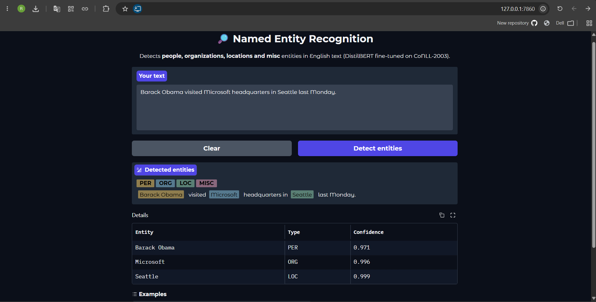
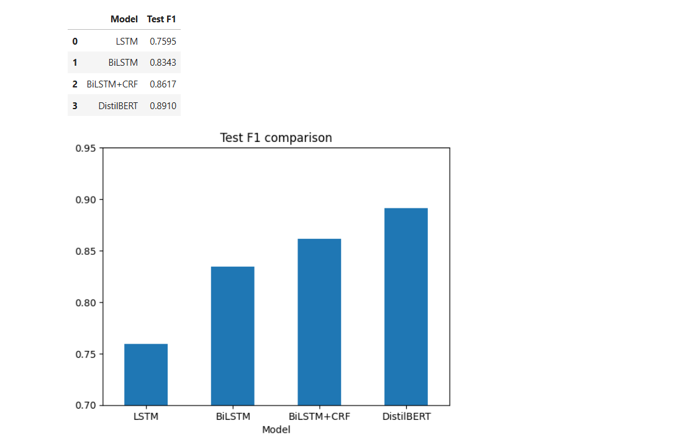

# Named Entity Recognition System

A sequence labeling pipeline that detects **people (PER), organizations (ORG), locations (LOC) and miscellaneous entities (MISC)** in English text. Three architectures are built from scratch in PyTorch (LSTM, BiLSTM, BiLSTM + CRF) and compared against a fine-tuned **DistilBERT**. The best model is deployed as an interactive **Gradio** app.



## Highlights

- End-to-end pipeline on **CoNLL-2003**: EDA, IOB tagging, vocabularies, training, seqeval evaluation, deployment.
- Pre-trained **GloVe (100d)** word embeddings plus a **character-level CNN** to handle OOV words (GloVe coverage: 87.6%).
- Three from-scratch models built from one configurable PyTorch class.
- DistilBERT fine-tuned with HuggingFace (`AutoTokenizer`, `AutoModelForTokenClassification`, `Trainer`) with subword-to-label alignment.
- Entity-level evaluation with **seqeval** (per-entity precision, recall, F1).
- Interactive Gradio app with color-coded entity spans and a confidence table.
- Fine-tuned model published on the Hugging Face Hub: [rAmZ-m/distilbert-ner-conll2003](https://huggingface.co/rAmZ-m/distilbert-ner-conll2003).

## Dataset

[CoNLL-2003](https://huggingface.co/datasets/eriktks/conll2003) (parquet version): 14,041 train / 3,250 validation / 3,453 test sentences.

Tags follow the **IOB scheme** (`B-X` starts an entity, `I-X` continues it, `O` is outside any entity) with four entity types: `PER`, `ORG`, `LOC`, `MISC`.

Key observations from the EDA:

- The data is heavily imbalanced: about 169k `O` tokens versus about 34k entity tokens, so accuracy is misleading and F1 is used instead.
- Average sentence length is 14.5 tokens, and 95% of sentences are shorter than 37 tokens.
- No lowercasing of the char input, and no stopword removal or stemming: capitalization is a strong signal for names, and removing tokens would break the token-label alignment.

## Models

| Model | Description |
|---|---|
| LSTM | GloVe + char-CNN input, unidirectional LSTM, softmax per token |
| BiLSTM | Same input, bidirectional LSTM |
| BiLSTM + CRF | BiLSTM with a CRF layer that learns tag transitions and decodes with Viterbi |
| DistilBERT | `distilbert-base-cased` fine-tuned for token classification |

From-scratch models: hidden size 128, dropout 0.5, char-CNN with 50 filters, Adam (lr 1e-3), gradient clipping, batch size 32, 10 epochs, best checkpoint chosen by validation F1.

DistilBERT: lr 5e-5, batch size 32, 3 epochs, weight decay 0.01. Only the first subword of each word keeps its label, the other subwords and special tokens get `-100`.

## Results

Test set, entity-level micro F1 (seqeval):

| Model | Test F1 |
|---|---|
| LSTM | 0.7595 |
| BiLSTM | 0.8343 |
| BiLSTM + CRF | 0.8617 |
| **DistilBERT** | **0.8910** |



Per-entity F1 on the test set:

| Model | LOC | MISC | ORG | PER |
|---|---|---|---|---|
| LSTM | 0.826 | 0.669 | 0.678 | 0.826 |
| BiLSTM | 0.888 | 0.717 | 0.790 | 0.879 |
| BiLSTM + CRF | 0.899 | 0.774 | 0.822 | 0.903 |
| DistilBERT | 0.921 | 0.765 | 0.860 | 0.949 |

## Where the CRF improves boundary detection

IOB has hard rules: for example, `I-PER` must follow `B-PER` or `I-PER`. A BiLSTM predicts each tag independently and can break them. The CRF learns transition scores between tags and picks the best sequence for the whole sentence.

Invalid IOB transitions on the test set:

| Model | Invalid transitions |
|---|---|
| BiLSTM | 180 |
| BiLSTM + CRF | 7 |

Example (`Italy recalled Marcello Cuttitta`): the BiLSTM predicted `B-LOC O B-ORG I-PER`, an entity that starts as ORG and continues as PER. The CRF corrected it to `B-LOC O B-PER I-PER`.

## Known limitations

- MISC is the weakest class for every model.
- The model is case-sensitive: on the fully lowercase sentence "i met barack obama in new york yesterday" it detected no entities.
- It can confuse names that are both a person and a place (the basketball player "Jordan" was tagged LOC instead of PER).
- It handled the ambiguous "Apple" (company) versus "apple" (fruit) case correctly.

Possible future work: train an uncased model, or augment training data with lowercased sentences.

## Run the app locally

```bash
python -m venv venv
venv\Scripts\activate        # Windows
pip install -r requirements.txt
python app.py
```

On the first run, the model is downloaded automatically from the Hugging Face Hub (about 260 MB, internet required) and cached for later runs. Then open `http://127.0.0.1:7860`.

Project structure:

```
.
├── app.py
├── images/
├── named-entity-recognition.ipynb
├── requirements.txt
└── README.md
```

The model weights are not stored in this repository. They are hosted on the [Hugging Face Hub](https://huggingface.co/rAmZ-m/distilbert-ner-conll2003).

## Use the model directly

```python
from transformers import pipeline

ner = pipeline("token-classification",
               model="rAmZ-m/distilbert-ner-conll2003",
               aggregation_strategy="simple")

print(ner("Barack Obama visited Microsoft headquarters in Seattle last Monday."))
```

## Tech stack

Python, PyTorch, pytorch-crf, HuggingFace Transformers, seqeval, gensim (GloVe), Gradio.

## Author

Ramez Malak Boushra, [GitHub](https://github.com/rAmeZ-m)
